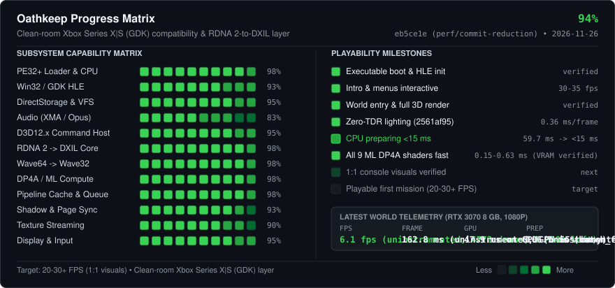

# Oathkeep

[](https://discord.gg/PM6pr4Azzk)

**Oathkeep** is an open-source, clean-room Xbox Series X|S (GDK) compatibility and binary translation layer for Windows, written in Rust.

It runs unmodified x86-64 console executables directly on a Windows host by providing high-level emulation (HLE) of console system libraries, Direct3D 12.x GPU translation, and RDNA 2-to-DXIL shader recompilation — strictly from files the user supplies locally.

> **Legal & Clean-Room Notice:** This repository contains **zero** copyrighted software, executables, keys, shaders, textures, audio, archives, or extracted data. You must supply your own legally obtained console software. Oathkeep is an independent open-source interoperability project and is not affiliated with, endorsed by, or connected to any console manufacturer, game developer, or publisher. See [docs/asset-policy.md](docs/asset-policy.md).

<!-- oathkeep:progress:start -->
## Compatibility & Performance Progress (95%)

Live dashboard: [thealexsan.github.io/oathkeep](https://thealexsan.github.io/oathkeep/) • Auto-generated from [docs/progress.toml](docs/progress.toml) via `cargo xtask progress`.



| Run | Commit | FPS | Frame | GPU | Preparing | Status |
| --- | --- | ---: | ---: | ---: | ---: | --- |
| diag-run92 | `ad52400` | 17.9 | 55.8 ms | 0.0 ms wait (0 hangs/TDRs in 130s at default 512 KiB) | 35.0-51.8 ms (batch_flush 18.2-27.6 ms, stale 4.8-6.0 ms, pre_prep sweep 1.7-5.2 ms) | Fix AA1-AA4 verified clean (isolated MIN_KB=128 hang from run91): 17.9 fps peak, drw=5788 batch_flush -39% (30->18.2 ms), stale -57% (11.4->4.9 ms), make_at -45% (77.2->42.3 ms), stage_cache 62% 1-shot bypass, pre_prep exposed WHY_SYNC sweep stall (1.7-5.2 ms/f, lock_wait 0.00 ms) -> next: Fix AB |
| diag-run90 | `perf/commit-reduction` | 16.6 | 60.4 ms | 0.0 ms wait (67-86% busy) | 34.8-46.6 ms (run_deferred 1.5-1.9 ms, snapshots 1.3-1.6 ms, back 13.6-18.4 ms) | Fix Z1-Z4 verified: run_deferred -68% (5.0->1.6 ms), snapshots -53% (3.0->1.4 ms), copy-back -30% (24->16 ms), compared MB -56% (33->14.4 MB), heavy 3D scenes +18-32% (drw=3958 9.8->11.6, drw=3449 11.7->13.8, drw=2473 10.4->13.7 fps); next: Fix AA (2-hit stage-cache admission filter + parallel card stale_under_flights + 128 KB card threshold) |
| diag-run89b | `cafadfe` | 18.3 | 54.5 ms | 0.0 ms wait (67-84% busy) | 33.0-45.9 ms (batch_flush 12.4-22.5 ms, moves 12.8-34.8 ms) | Fix Y1-Y4 verified: NEW PEAK 18.3 fps (54.5 ms/f), heavy scenes +17-38% (10.0->13.8, 9.3->11.9, 8.4->9.8 fps), 0 crashes/TDRs/refusals; next: Fix Z (batched CopyDescriptors, parallel GpuWrite flush, CARD_BUFFERS_MIN_KB=512, alias_apply hot-skip) |
| diag-run88 | `56618a9` | 17.4 | 57.3 ms | 0.0-1.5 ms wait (75-98% busy) | 29.5-64.9 ms (batch_flush 12.4-27.9 ms, moves 12.5-66.2 ms) | Fix X1-X3 verified: new peak 17.4 fps (57.3 ms/f), heavy-scene prep -28%, batch_flush -43%, moves -48%, rec -26%; 0 crashes/TDRs/refusals |
| diag-run82 | `perf/commit-reduction` | 15.9 | 62.7 ms | 0.0 ms wait (53-99% busy) | 36.5-53.1 ms (batch_flush 15.3-20.3 ms, moves shadow 12.1-17.5 ms, rec 121.6-129.2 ms, make_at 32.5-34.1 ms) | Fix S1-S3 verified: heavy scenes +16-43% (8.9->12.7, 10.9->11.9, 6.8->7.9 fps), lowest rec/make_at/batch_flush yet; stage_cache counter exposed 3.6k-7.3k misses/f from global SHADOW_GEN bumps + PrepOtherUs 6.4-10.9 ms -> next: Fix T |
| diag-run81 | `2fff334` | 17.3 | 57.7 ms | 0.0 ms wait (71-98% busy) | 36.2-57.4 ms (batch_flush 16.4-27.6 ms, moves shadow 11.3-29.7 ms, rec 134.9 ms) | New peak 17.3 fps (57.7 ms/f, +10% over run79)! Fix R1-R4 verified across all 3D intervals: between-submissions 30.7->23.4 ms, indirect miss_step -20%, 0 refusals/crashes |
<!-- oathkeep:progress:end -->

## Requirements

- **OS:** Windows 10 (19041+) or Windows 11, x64
- **CPU:** x86-64 with AVX2
- **GPU:** Direct3D 12 GPU with Shader Model 6.6 and Mesh Shaders (NVIDIA RTX 20-series+ or AMD RDNA 2+)
- **Memory:** 16–32 GB RAM and a sufficiently sized Windows paging file (if `crashes.log` reports Windows error `1455`, close background apps or increase the paging file)
- **Toolchain:** Rust (pinned in `rust-toolchain.toml`) and MSVC Build Tools

## Quick Start

### 1. Install the asset-policy pre-commit hook (recommended for contributors)

```powershell
cargo xtask install-hooks
```

### 2. Build Oathkeep

```powershell
cargo build -j 4 --release -p oathkeep
# Or with diagnostics enabled (captures, DRED, scripted keys, frame timing):
cargo build -j 4 --profile diag -p oathkeep --features diagnostics
```

### 3. Windows 10 only: install the Microsoft DirectX 12 Agility SDK

Windows 10's inbox `D3D12Core.dll` (`10.0.19041`) does not support Shader Model 6.6 dynamic resource root signatures (`0xc01`). Oathkeep exports `D3D12SDKVersion = 620` and `D3D12SDKPath = ".\D3D12\"`. Run our setup script once to fetch Microsoft's official `Microsoft.Direct3D.D3D12` `1.620.2` runtime DLLs into `target\release\D3D12\` and `target\diag\D3D12\` (outside git):

```powershell
powershell -ExecutionPolicy Bypass -File scripts\setup-agility-sdk.ps1
```

Windows 11 ships SM 6.6 inbox and does not require this step.

### 4. Launch a title

```powershell
# Safe default profile (recommended for 8 GB NVIDIA GPUs and first-run stability):
powershell -ExecutionPolicy Bypass -File scripts\play.ps1 -Exe "<path-to-your-title-exe>"

# Faster GPU scheduling profile (late waits + card buffers):
powershell -ExecutionPolicy Bypass -File scripts\play.ps1 -Exe "<path-to-your-title-exe>" -Profile fast

# 8 GB VRAM profile (enables levels-on-demand texture budgeting):
powershell -ExecutionPolicy Bypass -File scripts\play.ps1 -Exe "<path-to-your-title-exe>" -Profile nvidia8gb
```

Caches and saves are stored outside the repository under `%LOCALAPPDATA%\oathkeep\cache` and `%LOCALAPPDATA%\oathkeep\data` (overridable via `-Cache` / `-Data` or `oathkeep.toml`).

## Input Mapping

XInput controllers work natively. Without a controller connected, the keyboard acts as a controller while the title window has focus:

| Keys | Controller |
| --- | --- |
| `W A S D` / `I J K L` | Left / Right stick |
| Arrow keys | D-pad |
| `Enter`, `Backspace`, `X`, `Y` | A, B, X, Y |
| `Q` / `E`, `Z` / `C` | Shoulders, Triggers |
| `F` / `H` | Stick clicks |
| `Esc` / `Tab` | Menu / View |

## Repository Structure

See [docs/architecture.md](docs/architecture.md) for subsystem details:

- `apps/oathkeep` — `oathkeep` CLI (`run`, `inspect`, `census`, `translate`, `shader-info`, `lib-exports`, `config`)
- `crates/oathkeep-core` — configuration, logging, repo-boundary enforcement (`ensure_outside_repo`)
- `crates/oathkeep-pe` — read-only PE32+ and import-library parser
- `crates/oathkeep-loader` — PE32+ image preparation, TLS redirection, console CPU instruction emulation
- `crates/oathkeep-hle` — console OS, filesystem, DirectStorage, input, audio (XMA/Opus), and runtime HLE
- `crates/oathkeep-gpu` — Direct3D 12.x device, command lists, bindless heaps, texture/memory sync, host D3D12 backend
- `crates/oathkeep-shader` — RDNA 2 decoder, IR, optimization passes, and DXIL emitter
- `crates/oathkeep-formats` — texture layouts, BCPack, and audio codecs
- `crates/oathkeep-pipeline` — converter trait and content-addressed cache
- `crates/oathkeep-game` — build identification and format helpers
- `scripts/` — launcher (`play.ps1`) and Windows 10 Agility SDK setup (`setup-agility-sdk.ps1`)
- `xtask` — repository asset-policy enforcement (`cargo xtask policy`) and hook installer

## Diagnostics & Environment Switches

Build with `--profile diag --features diagnostics` (or pass `-Diag` to `scripts/play.ps1`) to enable diagnostic switches:

- `OATHKEEP_LOG=<target>=debug,info` — structured trace logging
- `OATHKEEP_D3D12_DRED=1` — Device Removed Extended Data (slows frames; use only to diagnose GPU hangs)
- `OATHKEEP_D3D12_WARP=1` — run on Microsoft's WARP software adapter
- `OATHKEEP_SHADER_LOOP_LIMIT=<n>` — bound translated shader loops
- `OATHKEEP_LATE_WAIT=3`, `OATHKEEP_WIDE_BACK=1`, `OATHKEEP_RELAY=2` — asynchronous GPU submission tuning
- `OATHKEEP_LEVELS_ON_DEMAND=1` — upload only populated mip levels (reduces VRAM usage on 8 GB GPUs)
- `OATHKEEP_PIPELINE_WAIT_MS=<ms>` — cap per-frame wait for background PSO compilation

## Contributing & Governance

- **Asset Policy (mandatory):** [docs/asset-policy.md](docs/asset-policy.md)
- **Contributing Guide:** [CONTRIBUTING.md](CONTRIBUTING.md)
- **AI Agent Guidelines:** [AGENTS.md](AGENTS.md)
- **Code of Conduct:** [CODE_OF_CONDUCT.md](CODE_OF_CONDUCT.md)
- **Security & Legal Contact:** [SECURITY.md](SECURITY.md)
- **Third-Party Credits:** [THIRD_PARTY.md](THIRD_PARTY.md)

## License

Oathkeep is licensed under the **GNU General Public License v3.0 or later** ([LICENSE](LICENSE)). See [THIRD_PARTY.md](THIRD_PARTY.md) for upstream and dependency attribution.
